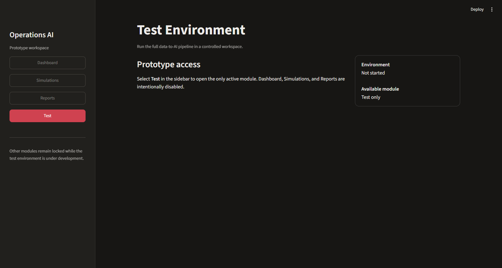
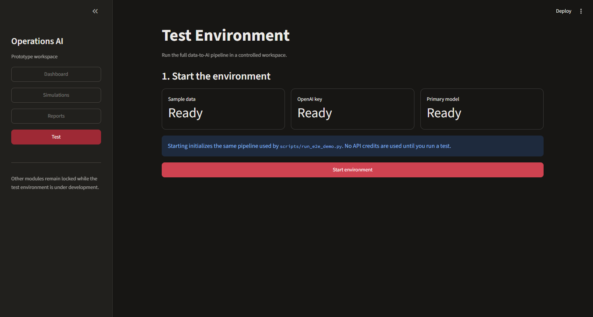
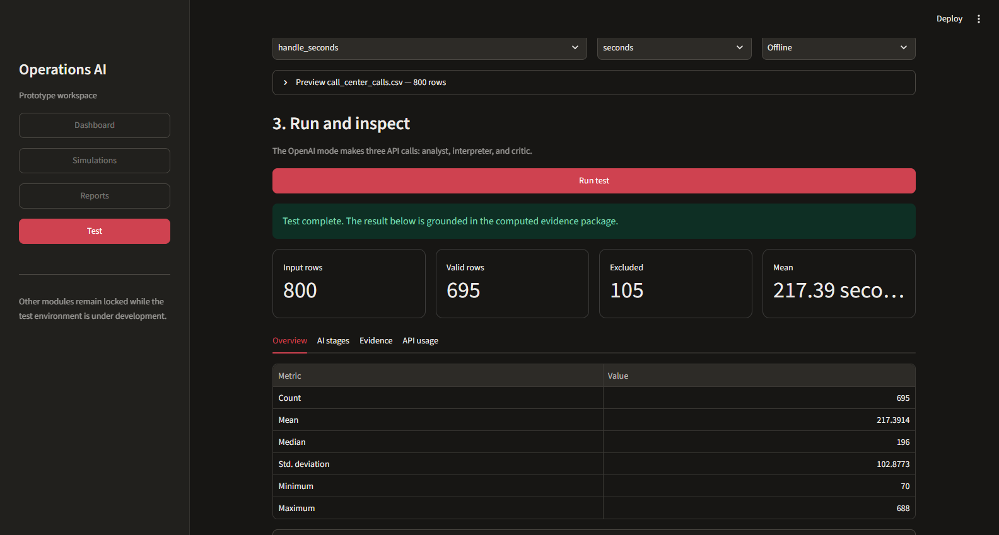

# Operations AI

This guide gets the test environment running on Windows.

## Setup

1. Open PowerShell in this repository and create a virtual environment:

   ```powershell
   python -m venv .venv
   .\.venv\Scripts\Activate.ps1
   ```

2. Install the project:

   ```powershell
   python -m pip install -e ".[dev]"
   ```

3. Copy the environment template:

   ```powershell
   Copy-Item .env.example .env
   ```

4. Open `.env` and replace the empty value with your own OpenAI API key:

   ```text
   OPENAI_API_KEY=your-key-here
   ```

   Do not share or commit `.env`.

## Start the test environment

Run:

```powershell
python -m streamlit run ui/streamlit_app.py
```

The first time Streamlit starts, it may ask for an email address. Leave it blank and press **Enter** to continue. Your browser will then open the application.

## Use the test environment

1. **Open Test.** Dashboard, Simulations, and Reports are intentionally disabled. Click **Test**.

   

2. **Start the environment.** Confirm that the sample data, API key, and model show **Ready**, then click **Start environment**. This step does not spend API credits.

   

3. **Run a test.** Use the included call-center sample or upload your own CSV. Select a numeric duration column, choose **OpenAI** or **Offline**, and click **Run test**. OpenAI mode makes exactly three bounded API calls.

4. **Review the result.** Use the Overview, AI stages, Evidence, and API usage tabs. You can also download the JSON report.

   

## Check your work

```powershell
python -m pytest
python -m ruff check .
```

For project structure and developer responsibilities, see [docs/ARCHITECTURE.md](docs/ARCHITECTURE.md).

For the three-developer agent ownership, sprint schedule, and definition of done, see [docs/TEAM_EXECUTION_PLAN.md](docs/TEAM_EXECUTION_PLAN.md).
